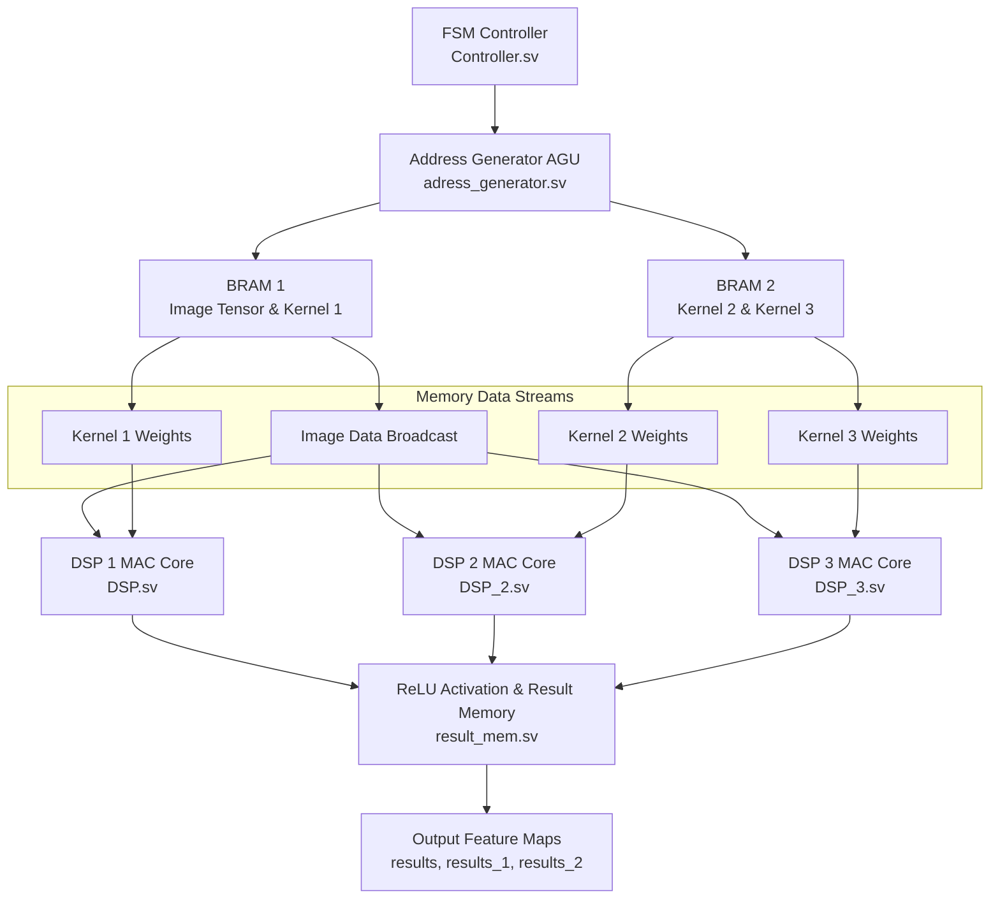

# CNN Accelerator Architecture (FPGA SystemVerilog)

[]()
[-orange?style=flat-square)]()
[]()
[](LICENSE)

A parameterized 3D Convolutional Neural Network (CNN) hardware convolution engine implemented in **SystemVerilog** within **AMD/Xilinx Vivado** (configured for target device `xc7vx485tffg1157-1`, Virtex-7). This project implements a multi-channel 3D convolution layer datapath featuring **3 parallel 27-bit MAC compute engines**, a **3D Address Generation Unit (AGU)**, **dual-port Block RAM tensor streaming**, and integrated **ReLU activation**.

> **Verification & Synthesis Status:**  
> This repository provides complete synthesizable RTL sources (`MAC.srcs/sources_1/new/`), memory initialization vectors (`.mem`), a self-contained Vivado project (`MAC.xpr`), and a behavioral verification testbench (`TB_CC_full.sv`) with verified cycle-accurate simulation outputs (`documenation/MAC_output.pdf`). Post-place-and-route FPGA utilization (LUT/FF/DSP48E1 counts) and maximum clock frequency ($f_{\max}$) depend on user timing constraints (`.xdc`) and synthesis settings; deterministic cycle latency equations are provided below.

---

## Project Overview

Convolutional Neural Networks (CNNs) are computationally dominated by multi-channel 3D Multiply-Accumulate (MAC) operations. Rather than evaluating output feature maps sequentially on a single ALU, this RTL design exploits **filter-level spatial parallelism**:
- Input image patch activations from `BRAM_1` are broadcast simultaneously to **three parallel MAC engines (`DSP.sv`, `DSP_2.sv`, `DSP_3.sv`)**.
- Each MAC engine streams its own dedicated 3D filter weights concurrently from dual-port Block RAMs (`BRAM_1.sv` and `BRAM_2.sv`), computing **3 output feature map channels per clock cycle**.

---

## Hardware Architecture and Datapath

The accelerator consists of five hardware modules integrated in [`CNN_TOP_module.sv`](MAC.srcs/sources_1/new/CNN_TOP_module.sv):

1. **Address Generation Unit (AGU)** ([`adress_generator.sv`](MAC.srcs/sources_1/new/adress_generator.sv)): Translates 3D spatial window coordinates `(channel, row, column)` into sequential 1D Block RAM read addresses.
2. **Execution Controller (FSM)** ([`Controller.sv`](MAC.srcs/sources_1/new/Controller.sv)): A finite state machine (`IDLE`, `RUN`, `DONE`) coordinating 2D sliding-window traversal, depth-channel accumulation, accumulator resets, and output write strobes.
3. **Dual-Port Block RAM Units** ([`BRAM_1.sv`](MAC.srcs/sources_1/new/BRAM_1.sv), [`BRAM_2.sv`](MAC.srcs/sources_1/new/BRAM_2.sv)): Dual-port synchronous memory arrays initialized from [`BRAM.mem`](BRAM.mem) (input tensor) and `Kernel_1.mem`–`Kernel_3.mem` (filter weights).
4. **3 Parallel MAC Compute Engines** ([`DSP.sv`](MAC.srcs/sources_1/new/DSP.sv), [`DSP_2.sv`](MAC.srcs/sources_1/new/DSP_2.sv), [`DSP_3.sv`](MAC.srcs/sources_1/new/DSP_3.sv)): Three concurrent Multiply-Accumulate units with 27-bit signed accumulators.
5. **ReLU Activation & Result Memory** ([`result_mem.sv`](MAC.srcs/sources_1/new/result_mem.sv)): Applies hardware $\max(0, x)$ rectification per channel upon completing all input depth channels and latches the output feature maps (`results`, `results_1`, `results_2`).



---

## Mathematical Formulation & Deterministic Cycle Latency

### 1. Multi-Channel 3D Convolution with ReLU
For an input tensor $X$ of shape $D \times H \times W$ and $C_{\text{out}} = 3$ parallel filters of spatial size $K = k_h \times k_w$:

$$Y_{c_{\text{out}}}(r, c) = \max \left( 0, \sum_{c_{\text{in}}=0}^{D-1} \sum_{i=0}^{K-1} X(c_{\text{in}}, r, c, i) \cdot W_{c_{\text{out}}}(c_{\text{in}}, i) \right)$$

### 2. Cycle-Count & Hardware Resource Model
| Architectural Parameter | Configured Value (`TB_CC_full.sv`) | Hardware / Timing Details |
| :--- | :---: | :--- |
| **Target FPGA Part (`MAC.xpr`)** | `xc7vx485tffg1157-1` | AMD/Xilinx Virtex-7 FPGA |
| **Input Tensor Dimensions ($H \times W \times D$)** | $5 \times 5 \times 2$ | 50 input elements in `BRAM.mem` |
| **Kernel Dimensions ($k_h \times k_w \times D$)** | $3 \times 3 \times 2$ ($K = 9$) | 3 parallel 3D filters (`Kernel_1..3.mem`) |
| **Output Feature Map Resolution** | $3 \times 3 \times 3$ | 9 spatial outputs $\times$ 3 channels = 27 outputs |
| **Parallel MAC Units** | `3` (`DSP`, `DSP_2`, `DSP_3`) | 27-bit accumulator width; maps to 3 DSP48E1 slices |
| **MAC Cycles per Output Pixel** | $K \times D = 9 \times 2 = 18\text{ cycles}$ | Computes all 3 output channels in parallel |
| **Total Convolution Compute Window** | $9\text{ patches} \times 18\text{ cycles} \approx 162\text{ cycles}$ | Complete 3-filter 3D convolution finishes within `< 2 us` at `100 MHz` |

---

## Repository Directory Structure

```text
CNN-accelerator/
├── MAC.srcs/
│   ├── sources_1/new/
│   │   ├── adress_generator.sv   # 3D spatial to 1D linear memory AGU
│   │   ├── Controller.sv          # Main execution FSM controller
│   │   ├── BRAM_1.sv              # Dual-port BRAM for image & Kernel 1
│   │   ├── BRAM_2.sv              # Dual-port BRAM for Kernel 2 & Kernel 3
│   │   ├── DSP.sv                 # Multiply-Accumulate (MAC) DSP core 1
│   │   ├── DSP_2.sv               # Multiply-Accumulate (MAC) DSP core 2
│   │   ├── DSP_3.sv               # Multiply-Accumulate (MAC) DSP core 3
│   │   ├── result_mem.sv          # ReLU activation and feature map storage
│   │   └── CNN_TOP_module.sv      # Top-level accelerator integration wrapper
│   └── sim_1/new/
│       └── TB_CC_full.sv          # System-level testbench environment
├── documenation/
│   ├── MAC_output.pdf             # Captured Vivado waveform and simulation output report
│   └── documetaion.txt            # Detailed module-by-module RTL design notes
├── BRAM.mem                       # Image tensor memory initialization file
├── MAC.xpr                        # Xilinx Vivado project file (xc7vx485tffg1157-1)
├── LICENSE                        # MIT License
└── README.md                      # Project architecture documentation
```

---

## Behavioral Simulation & Verification Evidence

The system testbench ([`TB_CC_full.sv`](MAC.srcs/sim_1/new/TB_CC_full.sv)) verifies multi-channel, 3-DSP convolution on a $5 \times 5 \times 2$ input tensor (`H=5, W=5, D=2`) with $3 \times 3$ kernels. Full waveform captures are available in [`documenation/MAC_output.pdf`](documenation/MAC_output.pdf).

### Verified Console Output (`depth = 2`):
```text
CONVOLUTION COMPLETE - MULTI-DSP RESULTS
======================================
Result_DSP1[0] = 0  |  Result_DSP2[0] = 7  |  Result_DSP3[0] = 47
Result_DSP1[1] = 0  |  Result_DSP2[1] = 6  |  Result_DSP3[1] = 54
Result_DSP1[2] = 0  |  Result_DSP2[2] = 7  |  Result_DSP3[2] = 63
Result_DSP1[3] = 0  |  Result_DSP2[3] = 10 |  Result_DSP3[3] = 90
Result_DSP1[4] = 0  |  Result_DSP2[4] = 13 |  Result_DSP3[4] = 101
Result_DSP1[5] = 0  |  Result_DSP2[5] = 12 |  Result_DSP3[5] = 112
Result_DSP1[6] = 0  |  Result_DSP2[6] = 17 |  Result_DSP3[6] = 141
Result_DSP1[7] = 0  |  Result_DSP2[7] = 16 |  Result_DSP3[7] = 152
Result_DSP1[8] = 0  |  Result_DSP2[8] = 19 |  Result_DSP3[8] = 163
======================================
```
*(Note: `Result_DSP1` outputs `0` across all 9 spatial positions because `Kernel_1` applies negative filter weights whose negative convolution sums are clamped to `0` by the hardware ReLU unit in `result_mem.sv`, validating ReLU rectification alongside positive accumulations on `DSP2` and `DSP3`).*

---

## How to Run Simulation & Synthesis in Xilinx Vivado

1. Clone the repository and open [`MAC.xpr`](MAC.xpr) in **AMD/Xilinx Vivado** (2019.1 or newer).
2. In the **Sources** pane under *Simulation Sources*, verify that `CNN_TOP_tb` (`TB_CC_full.sv`) is set as the top module.
3. Click **Run Simulation $\rightarrow$ Run Behavioral Simulation** and execute `run 2us` in the Vivado Tcl Console to reproduce the 9-element feature map table above.
4. To inspect FPGA resource utilization (DSP48E1, BRAM, LUT, FF), click **Run Synthesis** (`synth_1`, target part `xc7vx485tffg1157-1`) and open **Report Utilization** once synthesis completes.

---

## Author & License
- **Author**: Mohammad Usman Irshad ([@usman-irshad1](https://github.com/usman-irshad1))
- **Repository**: [`CNN-accelerator`](https://github.com/usman-irshad1/CNN-accelerator)
- **License**: Distributed under the [MIT License](LICENSE).
